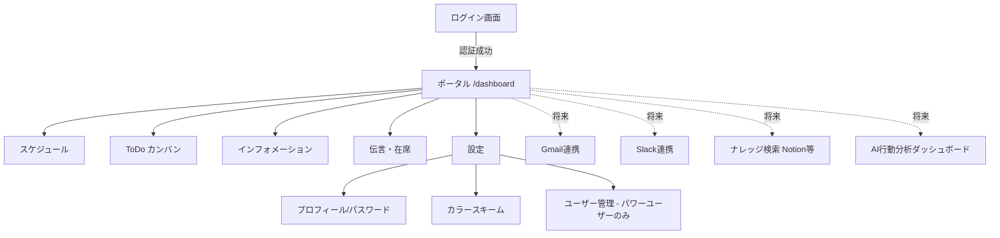
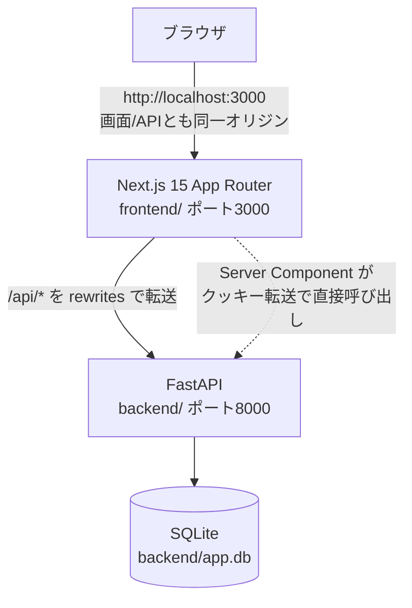
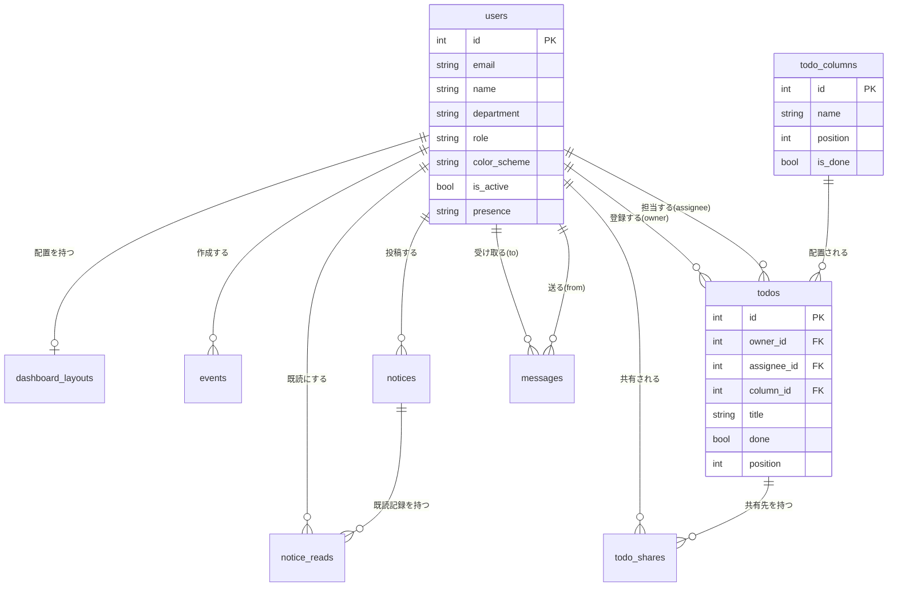
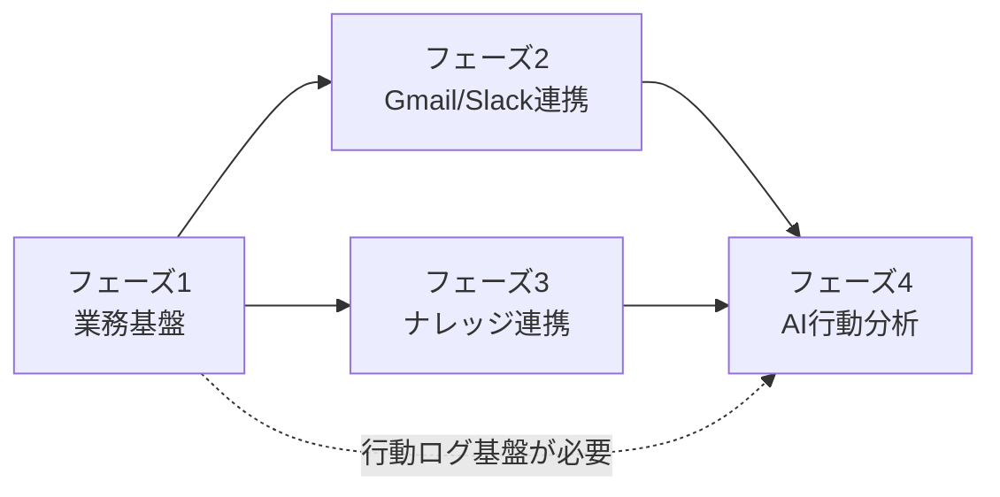

# 要件定義書：CoreDesk（社内グループウェア）

版数：v1.0
作成日：2026-09-22
作成者：shino

---

## 1. はじめに

### 1.1 本書の目的

本書は、社内グループウェア「CoreDesk」について、現時点で確定している要件（実装済み・稼働中の範囲）と、今後段階的に拡張していく構想（外部サービス連携、ナレッジマネジメント連携、AI活用）を整理し、開発・意思決定の合意文書とすることを目的とする。

現行機能はソースコード（`backend/`・`frontend/`）およびこれまでの引き継ぎ記録（`HANDOVER.md`・`docs/features.md`）の内容と一致させて記載している。将来構想（本書 第11章）は、方向性の合意を得るための構想レベルの記述であり、詳細設計は別途行う。

### 1.2 対象読者

- 開発担当者（実装・保守を行う本人および今後参加する開発者）
- 企画・意思決定者（機能追加の優先順位を判断する立場の人）
- 将来、外部連携やAI機能の設計を引き継ぐ担当者

### 1.3 用語定義

| 用語 | 意味 |
|---|---|
| パワーユーザー（power） | ユーザー管理（権限変更・有効/無効化）ができる権限。最初に登録した人が自動的になる |
| 一般ユーザー（user） | パワーユーザー以外。ユーザー管理を除く全機能を利用できる |
| ウィジェット | ポータル画面に並ぶカード型の部品（件数表示・今日の予定・メモ・時計など） |
| カンバン（ToDoボード） | 列（未着手/進行中/完了など）にカードを並べるToDo管理方式 |
| カラースキーム | ユーザーごとに選べる配色（暖色/中間色/寒色/ダークモード） |
| ナレッジマネジメント（KM） | 社内に蓄積された文書・議事録・ノウハウを整理し、検索・再利用可能にする仕組み。本書では将来構想として Notion 等との連携を想定 |
| 行動分析 | ユーザーの操作ログ（予定・ToDo・在席・投稿など）をAIが集計・分析し、業務の傾向や偏りを可視化する将来機能 |

---

## 2. プロジェクト概要

### 2.1 背景と課題

- 小規模チームにおいて、予定・ToDo・社内連絡・在席状況などの情報が、口頭・メール・個人のメモ・カレンダーアプリなどに分散し、探す手間や伝達漏れが発生していた。
- 情報共有ツール（メール＝Gmail、チャット＝Slack、ドキュメント＝Notion等）は既に個別に利用しているが、それぞれが独立しており、横断的に状況を把握する手段がない。
- 誰が何にどれだけ時間を使っているか（業務の偏り・ボトルネック）を定量的に把握する手段がなく、勘と経験に頼った運用になっている。

### 2.2 目的・ゴール

CoreDeskは、以下の段階を踏んで拡張していくことを前提とした社内グループウェアである。

| フェーズ | 到達目標 | 状態 |
|---|---|---|
| フェーズ1：業務基盤の統合 | 予定・ToDo・お知らせ・伝言/在席・ポータルを1つのシステムに集約する | **実装済み・稼働中**（本書 第4章で要件を確定） |
| フェーズ2：外部コミュニケーション連携 | Gmail・Slack と連携し、メール／チャットの情報もCoreDesk上で把握できるようにする | 未着手（第11章で構想を記述） |
| フェーズ3：ナレッジマネジメント連携 | Notion等の外部ナレッジベースと連携し、社内の文書・ノウハウを横断検索できるようにする | 未着手（第11章で構想を記述） |
| フェーズ4：AI活用（行動分析） | 蓄積された業務データ（予定・ToDo・投稿・在席・将来はメール/チャットのメタデータ）をAIが分析し、業務の傾向や改善点を提示する | 未着手（第11章で構想を記述） |

本書における**確定要件はフェーズ1のみ**とする。フェーズ2〜4は現時点では方向性の合意を目的とした構想であり、着手時期・詳細仕様は別途要件定義を行う。

### 2.3 スコープ

**対象範囲（フェーズ1・確定要件）**
- アカウント管理（登録・ログイン・ログアウト・権限）
- ポータル（ウィジェットの配置・並べ替え）
- スケジュール管理
- ToDo管理（カンバン方式、共有）
- 社内お知らせ（インフォメーション）
- 伝言・在席管理
- 新着バッジによる通知（ポーリング方式）
- 個人設定（プロフィール・パスワード・配色）
- ユーザー管理（パワーユーザーのみ）

**対象外（フェーズ1では扱わない）**
- Gmail・Slackとの実際の連携（第11章の構想止まり）
- Notion等の外部ナレッジベースとの連携
- AIによる行動分析・レコメンド
- ファイル添付、コメント機能、メール通知、外部カレンダー連携
- 予定の繰り返し登録・参加者招待
- パスワードリセット（メール送信によるもの）
- 招待制・承認制の新規登録（現状は「全員に公開」または「登録停止」の2択のみ）
- 多言語対応（日本語のみを前提）

---

## 3. 業務要件

### 3.1 現状業務（As-Is）と課題

| 業務 | 現状の手段（CoreDesk導入前） | 課題 |
|---|---|---|
| 予定共有 | 個人のカレンダーアプリ、口頭 | 他人の予定が分からない、二重予約 |
| タスク管理 | 付箋・個人のメモ・Excel | 進捗が見えない、担当が曖昧 |
| 社内連絡 | 口頭・メール・チャット | 全員に届いたか分からない、埋もれる |
| 在席確認 | 目視・内線 | 外出中か離席中か分からず電話が空振りする |
| 伝言 | 付箋・口頭 | 渡し忘れ・紛失 |
| メール（将来対象） | Gmail単体 | 業務の予定・タスクと連動していない |
| チャット（将来対象） | Slack単体（想定） | 決定事項が流れて埋もれる |
| ナレッジ（将来対象） | 個人のメモ、共有フォルダ | 属人化し、検索できない |
| 業務の偏り把握（将来対象） | 実施していない | ボトルネックや過負荷に気づけない |

### 3.2 あるべき業務（To-Be）

- 予定・ToDo・お知らせ・在席状況は、CoreDeskのポータルを見れば一目で把握できる。
- 伝言はモーダルで即座に残せ、対応済みかどうかが追跡できる。
- （将来）Gmail・Slackで発生した業務関連の情報（重要メール、決定事項など）がCoreDesk上のタスクや予定に反映される。
- （将来）議事録やノウハウはNotion等に集約されつつ、CoreDeskから横断的に検索・参照できる。
- （将来）AIが各人の予定・ToDo・在席・コミュニケーション量を分析し、偏りや停滞を早期に可視化する。

### 3.3 業務フロー（ログイン〜各機能の利用）

---

## 4. 機能要件（フェーズ1・確定要件）

### 4.1 機能一覧

優先度は MoSCoW（Must=必須／Should=推奨／Could=任意）。フェーズ1は稼働中のため大半がMustだが、未確認・改善余地のある項目にはShould/Couldを付与している。

| ID | 機能名 | 概要 | 優先度 | 状態 |
|---|---|---|---|---|
| F-01 | 新規登録・ログイン・ログアウト | メール/パスワードによる認証。最初の登録者がパワーユーザー | Must | 実装済み |
| F-02 | ポータル（ウィジェット） | カードの並べ替え・追加・削除・幅切替。ユーザーごとに保存 | Must | 実装済み |
| F-03 | スケジュール（月・週表示） | 予定の追加・編集・削除・ドラッグ移動、非公開設定 | Must | 実装済み |
| F-04 | ToDo（カンバン） | 列の追加/編集/削除/並べ替え、カードのドラッグ移動、共有 | Must | 実装済み |
| F-05 | インフォメーション | お知らせの投稿・削除・上部固定・既読管理 | Must | 実装済み |
| F-06 | 伝言・在席 | 在席状況の更新、伝言メモの送受信・対応済み管理 | Must | 実装済み |
| F-07 | 新着バッジ | ToDo/お知らせ/伝言の未対応件数を上部ナビに表示 | Must | 実装済み（他端末への即時反映はCould） |
| F-08 | 設定（プロフィール・配色） | 名前/部署の変更、パスワード変更、カラースキーム選択 | Must | 実装済み |
| F-09 | ユーザー管理 | 権限変更、有効/無効の切替（パワーユーザーのみ） | Must | 実装済み |
| F-10 | 新着バッジの即時同期（他端末） | 自分以外の画面にも即時反映（SSE/WebSocket） | Could | 未実装 |
| F-11 | 予定の繰り返し・参加者指定 | 定例予定、複数人が絡む予定の管理 | Should | 未実装 |
| F-12 | 招待制・承認制の新規登録 | 管理者の承認を経て登録させる方式 | Could | 未実装（現状は公開/停止の2択） |
| F-13 | パスワード再設定（メール） | パスワード忘れ時のセルフサービス再設定 | Should | 未実装 |
| F-14 | 完了ToDoの折りたたみ | 完了列のカードが増えた場合に古いものを畳む | Could | 未実装 |
| F-15 | カンバン列ごとの色固定 | 列の並び順に依存せず色を固定できるようにする | Could | 未実装 |

### 4.2 画面一覧

| 画面ID | 画面名 | パス | 概要 | 遷移元/先 |
|---|---|---|---|---|
| S-01 | ログイン | `/login` | メール/パスワードでログイン | 未認証時のリダイレクト先。成功時→S-03 |
| S-02 | 新規登録 | `/register` | 氏名・部署・メール・パスワードで登録 | S-01から遷移。成功時→S-03 |
| S-03 | ポータル | `/dashboard` | ウィジェットの一覧・並べ替え | 各機能画面への入口 |
| S-04 | スケジュール | `/dashboard/schedule` | 月/週表示、予定の追加・編集 | S-03から遷移 |
| S-05 | ToDo | `/dashboard/todos` | カンバンボード、詳細モーダル | S-03から遷移 |
| S-06 | インフォメーション | `/dashboard/notices` | お知らせの一覧・投稿 | S-03から遷移 |
| S-07 | 伝言・在席 | `/dashboard/office` | 在席一覧、伝言モーダル | S-03から遷移 |
| S-08 | 設定 | `/dashboard/settings` | プロフィール/配色/ユーザー管理タブ | 上部ナビの歯車アイコンから遷移 |

### 4.3 機能詳細（主要機能）

#### F-01 アカウント
- **入力**：氏名（100文字以内）、部署（100文字以内）、メールアドレス（一意）、パスワード
- **処理**：初回登録者を自動的に `role=power` とする。以降は `role=user`。パスワードはbcryptでハッシュ化。ログインはJWTを発行しHttpOnly CookieにセットしてSet-Cookie
- **出力**：ログイン状態のユーザー情報
- **例外**：メール重複時は409、認証失敗時は「メールアドレスまたはパスワードが正しくありません」の統一メッセージ（どちらが誤りかを教えない）、無効化ユーザーはログイン不可
- **環境依存**：`ALLOW_REGISTRATION=false` の場合、初回登録者以外の新規登録は403

#### F-03 スケジュール
- **入力**：件名（必須・200文字以内）、日付、開始/終了時刻（15分刻み）、場所（120文字以内）、メモ、非公開フラグ
- **処理**：自分の予定のみ編集・移動可（サーバー側でも所有者チェック）。非公開の予定は本人以外に非表示。取得は最大62日分
- **例外**：終了時刻が開始時刻より前の場合400、他人の予定への操作は403、存在しない予定は404

#### F-04 ToDo（カンバン）
- **列**：最大12列。完了列・未完了列はそれぞれ最低1つ必要（削除・種別変更時は400）。列は全ユーザーで共有
- **カード**：見える範囲は「自分が登録／自分が担当／自分に共有された」もののみ（`todo_visible()`に集約）。カードの移動は `before_id`（手前のカードのID）で位置を指定し、他人には見えないカードが同列にあっても順序がずれないようにする
- **共有**：登録者のみが共有先を設定可能（`PUT /todos/{id}/shares`）。共有された人は閲覧・移動・編集可、削除・共有変更は不可
- **完了判定**：`done` は常に「完了列に置かれているか」と一致させる（バッジ・件数の集計とズレないようにするための設計方針）

#### F-05 インフォメーション
- **入力**：件名（200文字以内）、本文、上部固定フラグ
- **処理**：自分が投稿したお知らせは常に既読扱い。既読はユーザーごとに記録
- **例外**：削除は投稿者本人のみ可（他は403）

#### F-06 伝言・在席
- **在席状況**：「在席／外出／離席／休み」＋ひとこと（120文字以内）を自分で更新
- **伝言**：宛先（有効なユーザーのみ）、電話の相手（120文字以内）、本文をモーダルで入力。受信者が「対応済み」にできる

#### F-07 新着バッジ
- **集計対象**：ToDo（未完了かつ自分が閲覧可能なもの）、お知らせ（自分の投稿を除く未読）、伝言（自分宛の未対応）
- **更新タイミング**：画面遷移時、60秒ごとのポーリング、および件数が変わる操作（投稿・既読・削除・対応済み等）の直後
- **既知の制約**：ToDoの「見た分」はブラウザのlocalStorageに保存するため端末ごとに独立する。他ユーザーの画面への反映はリアルタイムではなくポーリング（60秒間隔）に依存する

### 4.4 権限・ロール

| 操作 | 一般ユーザー | パワーユーザー |
|---|---|---|
| 自分の予定・ToDo・お知らせ・伝言・在席の操作 | ○ | ○ |
| ToDo列の追加・編集・削除・並べ替え | ○ | ○ |
| 他人の予定の編集・移動 | ×（403） | ×（403）※権限では緩和されない |
| 他人のToDoの編集（共有されていない場合） | ×（403） | ×（403） |
| プロフィール・パスワード・配色の変更 | ○（自分のみ） | ○（自分のみ） |
| ユーザー一覧の閲覧 | ×（403） | ○ |
| 権限（power/user）の変更 | ×（403） | ○ |
| ユーザーの有効/無効切替 | ×（403） | ○（自分自身は無効化不可、最後のパワーユーザーは降格・無効化不可） |

> 権限による制御は現状「ユーザー管理」機能のみに限定されている。それ以外の機能はロールに関わらず同一の操作性を持つ。

### 4.5 将来拡張機能（概要・優先度Could）

詳細は第11章。ここでは機能一覧としての位置づけのみ示す。

| ID | 機能名 | 概要 | フェーズ |
|---|---|---|---|
| F-20 | Gmail連携 | 業務関連メールの通知・要約表示、ToDo/予定への変換 | フェーズ2 |
| F-21 | Slack連携 | 重要メッセージの通知集約、CoreDeskからの投稿連携 | フェーズ2 |
| F-22 | ナレッジ連携（Notion等） | 外部ナレッジベースの横断検索、CoreDeskからのリンク・参照 | フェーズ3 |
| F-23 | AI行動分析 | 業務データを分析し、負荷の偏り・停滞・傾向を可視化 | フェーズ4 |

---

## 5. 非機能要件

### 5.1 性能

現行は「小規模チーム（数名〜数十名規模）」を前提としており、以下は**現時点の暫定目標値**（実測に基づく確定値ではないため、利用者数が増えた際は要再検討・要実測）。

| 項目 | 目標値 |
|---|---|
| 一覧系API（ToDo、お知らせ、伝言、予定範囲取得）のレスポンス | 想定同時利用者50名程度で 1秒以内 |
| バッジ取得API（`/api/dashboard/badges`） | 200ms以内（軽量集計のみで一覧を作らない設計） |
| ポータルまとめ取得API（`/api/dashboard/summary`） | 定期ポーリングには使用しない（README・HANDOVERに明記の既存方針）。画面初回表示時のみ使用し2秒以内を目安とする |
| 予定取得の期間上限 | 62日（既存制約） |

### 5.2 可用性

| 項目 | 内容 |
|---|---|
| 稼働率目標 | 社内利用ツールのため、営業時間帯（前提：平日9-19時）に99%程度を目安とする。24時間365日の高可用性構成は現時点では不要 |
| メンテナンス | コード変更時はバックエンドの再起動が必須（`--reload`なし運用時に既知の問題として発生実績あり）。計画メンテナンスは業務時間外に実施 |
| バックアップ | SQLiteファイル（`app.db`）の定期バックアップを運用要件とする（`deploy/backup.sh`が存在）。頻度・世代数は運用フェーズで確定 |
| データ移行 | スキーマ変更は起動時の自動マイグレーション（`upgrade_schema`系関数）で対応。破壊的変更時は事前バックアップを必須とする |

### 5.3 セキュリティ

| 項目 | 内容 |
|---|---|
| 認証方式 | JWT（HS256）をHttpOnly Cookieに格納。JavaScriptからのトークン読み取りを防止 |
| CSRF対策 | Cookieの`SameSite=Lax`属性で他サイトからのPOSTを抑止 |
| パスワード保護 | bcryptによるハッシュ化。ログイン失敗時はユーザー有無を区別しない応答＋タイミング攻撃対策（ダミーハッシュとの比較） |
| 通信の暗号化 | 本番公開時はHTTPS必須。`COOKIE_SECURE=true`時、`SECRET_KEY`が初期値または32文字未満だと起動を停止する安全装置あり |
| 認可 | パワーユーザー限定操作は`deps.py`の`PowerUser`依存で一元管理。ToDoの編集可否は所有者/担当者/共有先で判定 |
| 個人情報の扱い | 氏名・部署・メールアドレス・在席状況を保持。第三者への公開はしない（在席一覧にはメールアドレスを含めない設計） |
| 将来のAI/外部連携時の追加要件 | Gmail/Slackの認可はOAuth2.0を用い、必要最小スコープに限定する。行動分析でユーザーの操作ログを扱う場合、利用目的の社内周知と、必要に応じた匿名化・集計単位での分析を検討する（第11章） |

### 5.4 運用・保守

| 項目 | 内容 |
|---|---|
| ログ | 現状、アプリケーションログの体系的な収集は未整備（要検討事項）。エラー発生時はUvicorn標準出力に依存 |
| 監視 | 現状未整備。`/api/health`エンドポイントは死活監視用に用意済み |
| 障害対応 | 単一ノード構成のため、障害時はプロセス再起動が基本対応。冗長構成は非対応 |
| 更新方針 | コード更新時は手動デプロイ（`deploy/update.sh`）。マイグレーションはアプリ起動時の自動処理に統合 |

### 5.5 拡張性・移植性

- データベースはSQLiteを採用しているが、同時利用者増加時はPostgreSQL/MySQLへの移行と、Alembic等によるマイグレーション管理への切替を検討する（README・HANDOVERにも明記された既知の課題）。
- 将来の外部連携（Gmail/Slack/Notion/AI）を見据え、バックエンドAPIは機能ごとにルーター分割されており（`routers/`配下）、新規連携も同様の構成で追加できることを設計上の前提とする。
- フロントエンドはUIライブラリに依存しない素のCSS構成のため、将来的なUI刷新やコンポーネント差し替えの自由度は高いが、大規模化時はデザインシステムの導入を検討する。

---

## 6. システム構成・技術要件

### 6.1 現行システム構成図

### 6.2 技術スタック

| 区分 | 技術 |
|---|---|
| フロントエンド | Next.js 15（App Router）／React 19／TypeScript／素のCSS（UIライブラリ不使用） |
| バックエンド | Python／FastAPI／SQLAlchemy |
| データベース | SQLite（`backend/app.db`） |
| 認証 | JWT（PyJWT, HS256）＋ HttpOnly Cookie |
| パスワードハッシュ | bcrypt |
| テスト | pytest（APIレベルの結合テスト）、Playwright（E2E、Git管理外） |
| 公開方式（試験公開） | Cloudflare Tunnel（Windows環境）／VPS公開（Caddy + systemd想定、`docs/deploy.md`） |
| AIエージェント雛形 | `agent/` 配下、Azure OpenAI対応（本体機能とは現状未連携） |

### 6.3 外部連携・API

**現行（フェーズ1）**：外部サービス連携なし。フロントエンド／バックエンド間はREST API（`/api/*`）のみ。

**将来（フェーズ2〜4、詳細は第11章）**

| 連携先 | 想定方式 | 頻度・トリガー |
|---|---|---|
| Gmail | Gmail API（OAuth2.0） | 新着メール受信時のWebhook／定期ポーリング |
| Slack | Slack API（Events API / OAuth） | メッセージ投稿時のイベント連携、CoreDeskからの通知投稿 |
| Notion（ナレッジ管理） | Notion API | ページ更新時の同期、CoreDeskからの検索クエリ |
| AI（行動分析） | LLM API（Claude API等）／社内データの集計バッチ | 定期バッチ（日次/週次）でのログ集計・分析 |

---

## 7. データ要件

### 7.1 現行データモデル（フェーズ1）

| テーブル | 内容 | 保持期間の方針 |
|---|---|---|
| `users` | ユーザー（権限・配色・在席状況を含む） | アカウントが存在する限り保持。退職時は無効化（論理削除）で対応し、物理削除は現状未実装 |
| `dashboard_layouts` | ユーザーごとのウィジェット配置 | ユーザーと同じ |
| `events` | 予定 | 明確な保持期間なし（削除はユーザー操作による） |
| `todo_columns` | カンバンの列（全員共有） | システム設定に準ずる |
| `todos` | ToDoカード | ユーザー操作による削除まで保持 |
| `todo_shares` | ToDoの共有先 | 対象ToDo削除時に連動削除 |
| `notices` | 社内お知らせ | ユーザー操作による削除まで保持 |
| `notice_reads` | お知らせの既読記録 | お知らせと同じ |
| `messages` | 伝言メモ | ユーザー操作による削除は現状なし（対応済みフラグのみ） |

### 7.2 現行ER図

### 7.3 将来必要になるデータ（フェーズ2〜4、概要）

| データ種別 | 内容 | 発生元 |
|---|---|---|
| メールメタデータ | 件名・送信者・受信日時・重要度・紐付くToDo/予定ID | Gmail連携 |
| チャットメッセージメタデータ | チャンネル・投稿者・投稿日時・要約 | Slack連携 |
| ナレッジ記事の索引情報 | タイトル・更新日時・タグ・外部リンク | Notion等連携 |
| 行動ログ | 操作種別（ログイン、予定作成、ToDo完了等）・日時・所要時間の推定値 | CoreDesk本体の操作記録（新規追加が必要） |
| 分析結果 | 個人/チーム単位の集計指標、レコメンド文 | AI行動分析バッチ |

> 行動ログの取得は現行システムには存在しないため、フェーズ4着手前に個別の要件定義（何を・どの粒度で・どれだけの期間ログするか）が必要。

---

## 8. 制約条件・前提条件

- 本書のフェーズ1要件は、2026-09-22時点のソースコード（`backend/app/`・`frontend/src/`）およびHANDOVER.md・docs/features.mdの記載内容を正としている。
- 想定利用規模は「小規模チーム（数名〜数十名）」であり、大規模組織向けのスケーラビリティは前提としない。規模拡大時はデータベース・非機能要件の再検討が必須（第5.5節）。
- 外部連携（Gmail・Slack・Notion）は、いずれも各サービスのAPI利用規約・レート制限・認可の仕組みに依存する。契約プラン（無料/有料）によって利用可能なAPI範囲が変わる可能性がある。
- AI行動分析は、個人の業務ログを扱うため、社内での利用目的の周知・同意形成、および運用ルール（誰が結果を閲覧できるか等）の整備が実装の前提条件となる。本書はこの点を「要検討事項」として明記するに留め、詳細は着手時に別途定義する。
- マイグレーション管理ツール（Alembic等）は現状未導入。フェーズ2以降でスキーマ変更が頻発する場合は導入を検討する。
- 現行は単一Windows PCでの稼働（開発機 or 試験公開機）を前提とした構成であり、高可用性構成（複数台構成・自動フェイルオーバー）は対象外。

---

## 9. スケジュール・体制（概要）

本書作成時点では、詳細なスケジュール・体制は未確定。フェーズ単位の大まかな進め方の方針のみ示す。

| フェーズ | 内容 | 位置づけ |
|---|---|---|
| フェーズ1 | 業務基盤（現行機能）の整備・安定運用 | 完了（継続的な改善は第4.1節のShould/Could項目として残存） |
| フェーズ2 | Gmail・Slack連携の要件定義・PoC | 未着手。着手前に第11章の構想を基に個別の要件定義書を作成する |
| フェーズ3 | ナレッジマネジメント（Notion等）連携 | 未着手。フェーズ2の知見（外部API連携の実装パターン）を踏まえて着手する想定 |
| フェーズ4 | AI行動分析 | 未着手。フェーズ1〜3で蓄積したデータ・連携基盤を前提とするため、最終フェーズと位置づける |

体制（開発者数、役割分担）は現時点で個人開発を前提としており、拡張時に見直す。

---

## 10. 概算費用

現行フェーズ1は、既存インフラ（開発者所有のWindows PC、既存ドメイン、Cloudflare Freeプラン等）の範囲で運用しており、追加のランニングコストは発生していない（`HANDOVER-2.md`記載の方針を踏襲）。

フェーズ2以降で発生しうる費用項目（概算前提であり、確定額ではない）：

| 項目 | 想定費用の性質 |
|---|---|
| Gmail API / Google Workspace | 既存Googleアカウントの範囲であれば追加費用は原則不要（利用量次第でクォータ超過の可能性あり） |
| Slack API | Slackの契約プランに依存（無料プランでは一部機能・履歴保持に制限） |
| Notion API | Notionの契約プランに依存 |
| AI（LLM API利用） | トークン量に応じた従量課金。行動分析の実行頻度・データ量により変動するため、フェーズ4着手時に見積もりを行う |
| サーバー増強 | 利用者数増加やAI処理の負荷次第では、現行のWindows PC単体構成から専用サーバー/VPSへの移行費用が発生する可能性あり |

---

## 11. 将来構想・拡張ロードマップ（フェーズ2〜4）

本章は、冒頭に述べた思想「Gmail・Slack連携」「Notion等を用いたナレッジマネジメント連携」「AI活用による行動分析」を、現行アーキテクチャとの接続点を意識して構想レベルで整理したものである。**本章の内容は合意形成のためのたたき台であり、着手時には各フェーズごとに独立した要件定義書を作成する。**

### 11.1 フェーズ2：Gmail・Slack連携

**目的**：業務に関連するメール・チャットの情報を、CoreDesk上の予定・ToDo・お知らせと結び付け、情報の分散を減らす。

**構想する機能**
- Gmailの重要メールを検知し、ポータルにウィジェットとして表示する。
- メールからToDo・予定をワンクリックで起票する（メールの件名・本文を初期値として利用）。
- Slackの特定チャンネルの重要メッセージ（ピン留め等）をCoreDeskの「インフォメーション」に転記、またはリンク表示する。
- CoreDesk側の操作（お知らせ投稿、伝言の未対応など）をSlackへ通知する（現行のバッジ即時同期の課題＝F-10の解決にもつながる）。

**技術的な接続点**
- 認可：Google/Slack双方でOAuth2.0によるユーザーごとの認可が必要。CoreDeskの`users`テーブルに外部連携用のトークン保存領域（暗号化必須）を追加する設計になる見込み。
- 新規ルーター：`routers/integrations_gmail.py`、`routers/integrations_slack.py`のように、既存の機能別ルーター分割方針を踏襲する。
- Webhook受信：Slack Events API、Gmail Pub/Sub通知等、外部からの受信エンドポイントが新たに必要（現行は外部からの着信を持たない設計のため、セキュリティレビューが必須）。

**未確定事項（着手前に要検討）**
- メール本文をどこまでCoreDesk側に保存するか（プライバシー・容量の観点）。
- 個人のGmail/Slackアカウントを連携するのか、部署共有アカウントを連携するのか。
- 通知の重複（Slack本体の通知とCoreDeskのバッジ通知が両方鳴る等）をどう整理するか。

### 11.2 フェーズ3：ナレッジマネジメント連携（Notion等）

**目的**：属人化しがちな議事録・手順書・ノウハウを、外部ナレッジベース（Notion等）に集約しつつ、CoreDeskから横断的に参照・検索できるようにする。

**構想する機能**
- CoreDesk上に「ナレッジ」ウィジェット／画面を新設し、Notion等のページタイトル・更新日時・タグを一覧表示する。
- CoreDesk内の検索から、Notion側のページも横断的にヒットするようにする（インデックスの同期方式は要検討：都度API検索 or 定期インデックス作成）。
- ToDo・お知らせから、関連するナレッジページへのリンクを貼れるようにする。

**技術的な接続点**
- Notion API（またはNotionに限定しない抽象化：将来的に他のナレッジツールへの差し替えも見据え、`KnowledgeProvider`のようなインターフェースを設ける方針が望ましい）。
- 検索機能を新設する場合、全文検索の方式（SQLiteのFTS5、または外部検索エンジンの導入）を別途検討する。

**未確定事項**
- Notion側のワークスペース構成（どの範囲を連携対象にするか）が未定。
- 検索の即時性（リアルタイム同期か、定期バッチか）の要件が未定。

### 11.3 フェーズ4：AI活用（行動分析）

**目的**：CoreDesk上に蓄積される業務データ（予定・ToDo・在席・将来はメール/チャットのメタデータ）をAIが分析し、業務の偏り・停滞・生産性の傾向を可視化することで、マネジメントの意思決定を支援する。

**構想する機能**
- 個人／チーム単位のダッシュボード：ToDoの滞留日数、予定の稼働率、伝言の対応速度などの指標を可視化。
- 異常検知：特定の人に業務が集中している、特定のToDo列にカードが滞留している、といった傾向をAIが検知し通知する。
- 自然文での問い合わせ：「先週チームで一番忙しかったのは誰？」のような質問にAIが業務データを根拠に回答する（`agent/`配下の雛形との連携を想定）。

**技術的な接続点**
- 現行の`agent/`（ローカルAIエージェントの雛形、Azure OpenAI対応）を本体データと接続する。現状「本体のデータにはまだつながっていない」（docs/features.md記載）ため、まずは読み取り専用API経由でのデータ提供から着手するのが現実的。
- 行動ログの新規収集：現行スキーマには操作ログの記録機能が存在しないため、新規テーブル（例：`activity_logs`）の追加が必要になる見込み。
- 分析処理：リアルタイム性は不要と想定されるため、定期バッチ（日次/週次）での集計を基本方式とする。

**未確定事項（最重要）**
- **プライバシー・労務上の配慮**：個人の行動を分析する機能は、目的の周知・本人同意・閲覧権限の設計（本人のみ／上長のみ／全員に公開、等）を、実装前に社内で合意する必要がある。本書ではこれを「フェーズ4着手の前提条件」として明記する。
- 分析結果の粒度（個人単位で出すか、チーム単位に集約して匿名性を保つか）。
- 誤検知・誤った評価につながらないよう、指標の設計には慎重な検討が必要（例：ToDoの滞留＝サボりとは限らない）。

### 11.4 フェーズ間の依存関係

フェーズ4（AI行動分析）は、フェーズ2・3で蓄積される外部データと、フェーズ1で稼働する業務データの両方を材料とするため、最終フェーズと位置づける。ただし、フェーズ1データのみでも「予定の稼働率」「ToDoの滞留」等の限定的な分析は先行して着手可能であり、必要であればフェーズ4の一部を前倒しすることも選択肢となる。

---

## 12. 品質チェック（本書のセルフレビュー）

- [x] フェーズ1（確定要件）とフェーズ2〜4（将来構想）を明確に区分した
- [x] 機能一覧に優先度（MoSCoW）を付与した
- [x] 対象外（スコープ外）を明記した
- [x] 非機能要件の数値目標を明記した（暫定値である旨も明記）
- [x] 仮定・前提条件を第8章にまとめた
- [x] ER図・構成図・フロー図をMermaidで記載した
- [ ] フェーズ2〜4の詳細要件（本書は方向性のみ。着手時に個別の要件定義書が必要）
- [ ] AI行動分析におけるプライバシー・労務面のルール（社内合意が前提。本書では前提条件として明記するに留める）
