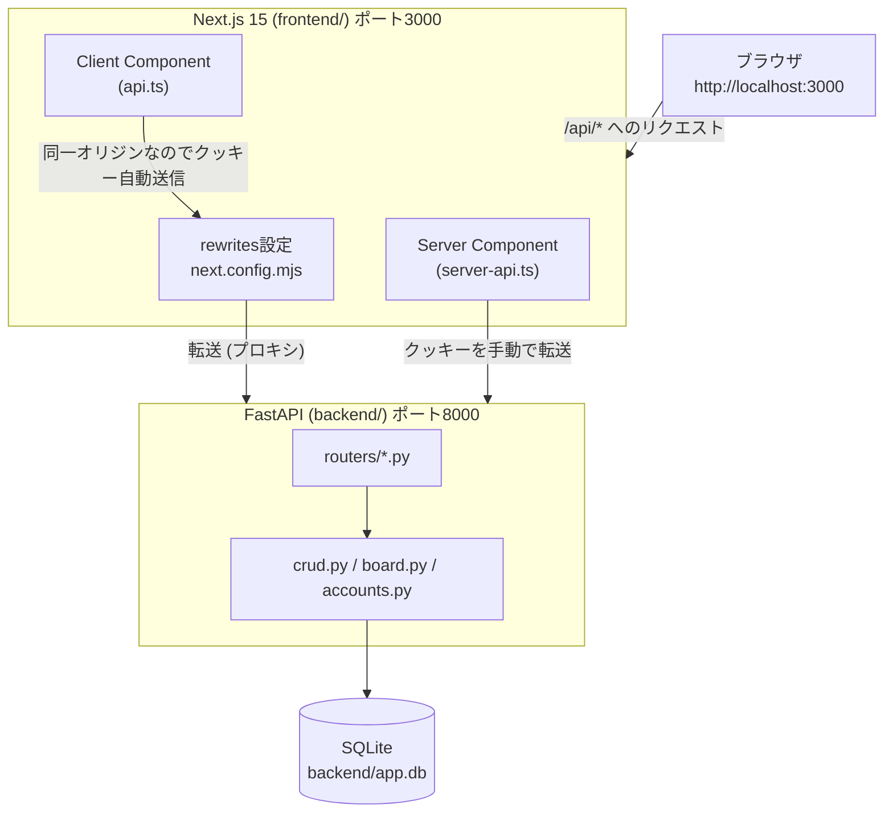
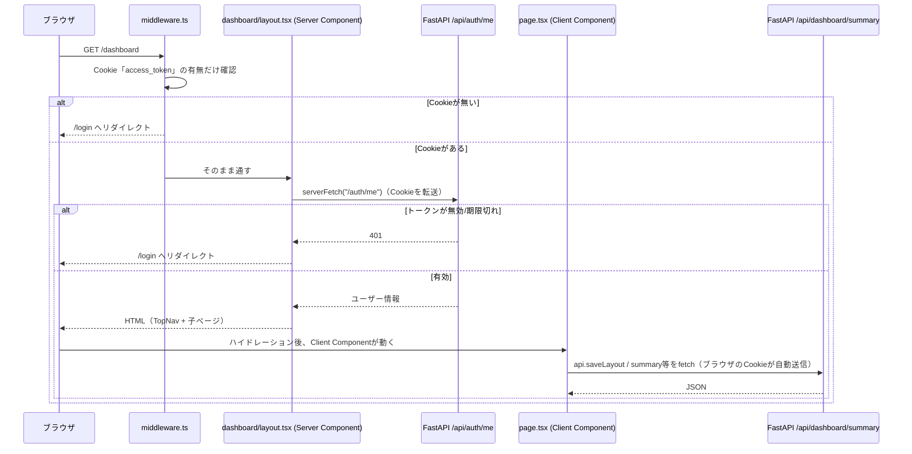
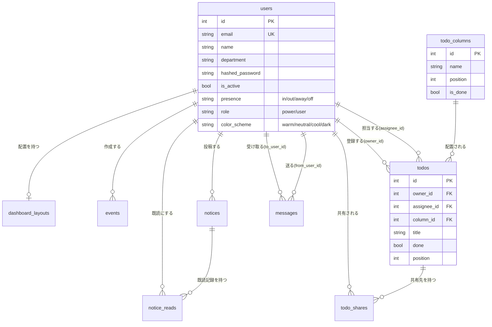
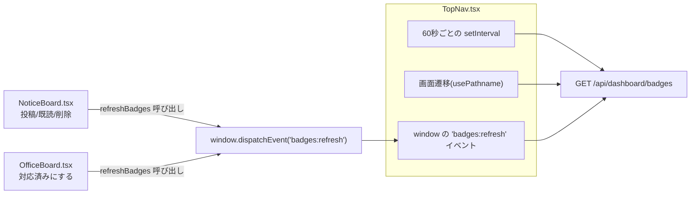

# 技術解説書：CoreDesk

作成日：2026-09-22
対象：CoreDeskのソースコード（`backend/`・`frontend/`）を初めて読む人向けの技術解説

## この文書について

CoreDeskの「何ができるか」は `README.md` と `docs/features.md` に、「どういう経緯で今の形になったか」は `HANDOVER.md` に書かれている。
本書はそれらとは別に、**実際のコードがどう動いているか**を、初めてこのリポジトリを触る人が迷わないように解説するものである。

読み進める順番の目安：

1. 第1章（全体像）で、なぜ「Next.jsとFastAPIを分けて、Next.js側で1つのオリジンに見せる」構成にしているかを理解する
2. 第2章（1回のリクエストの流れ）で、ブラウザ操作がどうDBまで届くかを追う
3. 第3〜4章（認証・DB）で、土台の仕組みを理解する
4. 第5〜6章（バックエンド・フロントエンドの設計判断）で、個々の機能のコードを読むときに迷わないための「なぜこうなっているか」を押さえる
5. 第7章以降は、テスト・落とし穴・カスタマイズ入口のリファレンスとして必要なときに参照する

---

## 1. システム全体像

CoreDeskは、画面（Next.js）とAPI（FastAPI）を別プロセスで動かしつつ、**ブラウザからは1つのサイトに見せる**構成を取っている。



**なぜこの構成か**

- ブラウザは常に `http://localhost:3000/api/...` だけを呼ぶ。Next.jsの `rewrites`（`frontend/next.config.mjs`）が裏で `http://127.0.0.1:8000/api/...` に転送する。
- 同一オリジンに見えるため、**CORS設定が不要**で、ログインCookieも普通に送られる（別オリジンだとCookieの扱いが一気に面倒になる）。
- それでも `main.py` にCORSミドルウェアが入っているのは、フロントから直接バックエンドを叩く開発時の保険。

Server Component（`dashboard/layout.tsx` など、サーバー側で実行されるコード）は、ブラウザの中で動いているわけではないので rewrites の恩恵を受けられない。そのため `lib/server-api.ts` が **自分でクッキーを読んで転送**し、バックエンドへ直接アクセスする。この「2つのAPIクライアントが存在する理由」は、CoreDeskのコードを読むときに最初に押さえておくべきポイントである。

---

## 2. 1回のリクエストの流れ（具体例：ダッシュボードを開く）



ポイントは**二段構えの認証チェック**になっていること。

- `middleware.ts` は「Cookieが存在するか」しか見ない、軽い門番。これはページ遷移時のちらつき防止のためで、正式な認証確認ではない。
- 本当の確認は `dashboard/layout.tsx` が `serverFetch("/auth/me")` を呼んだ結果で行う。ここで401が返れば `server-api.ts` の中で `redirect("/login")` する。

この二段構えのおかげで、Cookieが盗まれた古いブラウザタブなどでも、実際のAPI呼び出しレベルでは必ずJWTの検証が行われる。

---

## 3. 認証の仕組み

### 3.1 ログイン〜Cookie発行

```
POST /api/auth/login { email, password }
  → security.verify_password() でbcrypt照合
  → security.create_access_token(user_id) でJWT発行（有効期限 = 24時間、settings.access_token_expire_minutes）
  → response.set_cookie(...) で HttpOnly Cookie にJWTをセット
```

`backend/app/routers/auth.py` の `_set_login_cookie()` が設定するCookie属性の意味：

| 属性 | 値 | 意味 |
|---|---|---|
| `httponly` | `True` | JavaScriptから `document.cookie` で読めない。XSSでトークンを盗まれにくくする |
| `secure` | `settings.cookie_secure`（既定`False`） | `True`にするとHTTPS接続のときしかCookieが送られない。本番公開時は必ず`True`にする |
| `samesite` | `"lax"` | 他サイトの `<form>` からのPOSTなどにCookieを付けない。CSRF対策 |

### 3.2 リクエストごとの検証

`backend/app/deps.py` の `get_current_user()` が、保護されたエンドポイントすべてで共通に使われる：

```python
def get_current_user(db, token: str | None = Cookie(...)) -> User:
    if not token: raise 401
    user_id = decode_access_token(token)   # 署名とexpを検証
    if user_id is None: raise 401
    user = db.get(User, user_id)
    if user is None or not user.is_active: raise 401   # 無効化されたユーザーも弾く
    return user
```

FastAPIの `Depends` で各ルーターの引数に `CurrentUser` と書くだけで、この一連のチェックが自動的に挟まる（`deps.py` で `CurrentUser = Annotated[User, Depends(get_current_user)]` と定義されている）。パワーユーザー限定の操作も同様に `PowerUser`（`require_power_user` を経由）を型として書くだけでよい。

### 3.3 パスワードまわりの工夫

- `security.py` の `DUMMY_HASH`：存在しないメールアドレスでログインしようとしても、実在するユーザーと同じだけ時間をかけてbcrypt比較を行う。これにより「このメールは登録されているか」をレスポンス時間差で推測されにくくしている（タイミング攻撃対策）。
- ログイン失敗時のメッセージは常に「メールアドレスまたはパスワードが正しくありません」で統一し、どちらが誤りかを教えない。

---

## 4. データベース設計

### 4.1 ER図



### 4.2 「マイグレーションツールなし」で運用する仕組み

CoreDeskはAlembicのようなマイグレーションツールを使わず、**アプリ起動のたびに自分でスキーマを直す**方式を取っている（`backend/app/main.py` の `lifespan`）。

```python
Base.metadata.create_all(bind=engine)     # SQLAlchemyのモデルから「無いテーブル」だけ作る
board.upgrade_schema(engine)              # todos に column_id / position が無ければ ALTER TABLE で追加
accounts.upgrade_schema(engine)           # users に role / color_scheme が無ければ ALTER TABLE で追加
accounts.ensure_power_user(db)            # パワーユーザーが0人なら、最古の有効ユーザーを昇格
board.seed_and_backfill(db)               # 列が0個なら初期3列を作成し、置き場所未設定のToDoを振り分け
```

`create_all` は**新規テーブルの作成**しかできず、既存テーブルへの**列追加**はしてくれない。そこで `upgrade_schema` 系の関数が `inspect(engine).get_columns(...)` で今のテーブル定義を調べ、足りない列だけ `ALTER TABLE` で追加している。何度起動してもすでに列があれば何もしないので安全（冪等）。

この方式は開発初期の小さいプロジェクトでは手軽だが、**列の削除や型変更、複雑な移行には対応できない**。本番運用でスキーマ変更が増える場合は、README/HANDOVER双方に記載の通りAlembic導入が推奨される。

---

## 5. バックエンドの設計判断

### 5.1 ディレクトリの役割分担

```
backend/app/
  main.py            起動処理(lifespan)・ルーター登録・CORS
  config.py          環境変数の読み込み(pydantic-settings)
  database.py        SQLAlchemyのエンジン・セッション
  models.py          テーブル定義(9テーブル)
  schemas.py         入出力の型(Pydantic)。バリデーションもここに集約
  security.py        パスワードハッシュ・JWT発行/検証
  deps.py            「ログイン中ユーザー」「パワーユーザー」の取得をDIで提供
  accounts.py        権限・配色にまつわるロジック + 自動マイグレーション
  board.py           ToDoカンバンの列・カード配置ロジック + 自動マイグレーション
  crud.py            一覧・件数の取得ロジック(複数画面で共用)
  routers/           HTTPエンドポイントの定義(機能ごとに分割)
```

「ロジックをどこに書くか」の方針は一貫している：**HTTPの関心事（ステータスコード・入出力の型）は `routers/` に、業務ロジックは `crud.py` / `board.py` / `accounts.py` に**、という分担。これにより、複数の画面から同じデータを参照するときに実装がずれる事故を防いでいる。

### 5.2 「1箇所にまとめる」ことへのこだわり

CoreDeskのコードには、意図的に**同じ条件判定を1箇所にまとめている**箇所がいくつかある。これは`crud.py`のdocstringにも明記されている設計方針で、読み解く価値が高い。

**例1：ToDoの可視範囲（`crud.py` の `todo_visible()`）**

```python
def todo_visible(user: User):
    shared = select(TodoShare.todo_id).where(TodoShare.user_id == user.id)
    return (Todo.assignee_id == user.id) | (Todo.owner_id == user.id) | Todo.id.in_(shared)
```

この関数はSQLAlchemyの「絞り込み条件（WHERE句の式）」を返す。呼び出し側は以下の3箇所すべてでこれを使う：

- `todos_for()`（ToDo画面の一覧）
- `badge_counts()`（メニューのバッジ件数）
- （将来、ポータルの件数ウィジェットなどを増やす場合も同様に使う）

もし可視範囲のルールを個別に書いてしまうと、「一覧には出るのにバッジには出ない」といったズレが起きる。実際、README・HANDOVERにも「`badge_counts()`と各一覧は同じ条件で数えている。片方だけ直すとズレる」という注意書きがあるのはこのため。

**例2：ToDoの編集可否（`routers/todos.py` の `_editable()`）**

```python
def _editable(db, user, todo_id, allow_shared=True) -> Todo:
    allowed = user.id in (t.assignee_id, t.owner_id)
    if not allowed and allow_shared:
        allowed = db.get(TodoShare, (t.id, user.id)) is not None
    if not allowed:
        raise HTTPException(403, "このToDoは編集できません")
    return t
```

`update`（内容変更）・`move`（列移動）は `allow_shared=True` で呼び、共有された人にも許可する。`delete`・`share`（共有設定の変更）は `allow_shared=False` で呼び、登録者本人だけに絞る。**同じ判定関数に引数を1つ足すだけ**で、権限の強弱を表現している。

### 5.3 ToDoカンバンの「位置」をどう管理しているか

カードの並び順は `Todo.position`（整数、小さいほど上）で管理する。ここで工夫が要るのは、**ユーザーには見えないカード（他人のToDo）が同じ列に混ざっている**ケースである。もし「上から何番目に置くか」を単純なインデックスで指定すると、見えないカードの分だけズレてしまう。

そこでCoreDeskは、**「どのカードの手前に置くか」をカードのIDで指定する**方式（`before_id`）を取っている（`board.py` の `place()`）。

```python
def place(db, todo, column, before_id=None):
    # その列にある「todo自身を除く全カード」を今の並び順で取得(見えないカードも含む)
    cards = [...]
    if before_id is None:
        index = len(cards)          # 指定が無ければ末尾
    else:
        index = [c.id for c in cards].index(before_id)   # 指定のIDの位置を探す
    cards.insert(index, todo)
    for i, c in enumerate(cards):
        c.position = i              # 列全体のpositionを振り直す
```

フロントエンドのドラッグ操作は「このカードの上に来た」というDOM上の隣接関係から `before_id` を算出し、`POST /api/todos/{id}/move` に送るだけでよい。バックエンドは常に列全体（自分に見えないカードも含む）を並べ直すので、複数人が同時に同じ列を編集していても矛盾が起きにくい。

また、`apply_done()` により「完了列に置かれたら`done=true`、それ以外なら`done=false`」を**カードを動かすたびに必ず揃える**。これにより、`done` フラグを見るだけの他のロジック（バッジ件数、ポータルの件数など）が、カンバンの列構成を意識せずに済む。

### 5.4 バッジ集計が「軽い」理由

`GET /api/dashboard/badges` は、一覧を組み立てずに `SELECT COUNT(...)` だけを実行する（`crud.py` の `badge_counts()`）。60秒ごとのポーリングと、操作直後の即時呼び出しの両方で使われる想定のため、意図的に「一覧を作らない・件数だけ数える」設計にしている。対して `GET /api/dashboard/summary` は予定・ToDo・お知らせ・伝言・メンバー一覧をまとめて返す重いAPIで、**ポータルの初回表示にのみ使う**という運用上の使い分けがコメントで明記されている。

---

## 6. フロントエンドの設計判断

### 6.1 App Routerのディレクトリ構成

```
frontend/src/app/
  layout.tsx              全体の<html>。THEME定数でテーマ(instrument/blueprint)を選択
  login/, register/       認証前の画面(middlewareの対象外)
  dashboard/
    layout.tsx             Server Component。/auth/me で認証確認 + カラースキームの適用 + TopNav描画
    page.tsx                ポータル本体
    schedule/, todos/, notices/, office/, settings/   各機能の画面
```

`dashboard/layout.tsx` 配下の画面はすべて、この1つのレイアウトの中で認証確認とナビゲーション表示を済ませてから描画される。個々の `page.tsx` は「認証済み前提」でロジックを書けるため、認証チェックのコードが機能画面側に散らばらない。

### 6.2 2つのAPIクライアントの使い分け

| | `lib/api.ts` | `lib/server-api.ts` |
|---|---|---|
| 実行場所 | ブラウザ（Client Component） | Next.jsサーバー（Server Component） |
| Cookieの扱い | ブラウザが自動送信（同一オリジンのため） | `cookies()` で読み取り、手動でヘッダーに付与 |
| 呼び出し先 | 相対パス `/api/...`（rewritesで転送） | `BACKEND_URL` を直接指定してFastAPIへ |
| 401時の挙動 | `ApiError` を投げる（呼び出し側でハンドリング） | `redirect("/login")` を直接実行 |
| 主な用途 | フォーム送信、ドラッグ操作など、画面内の操作 | ページ初回表示時のデータ取得・認証確認 |

新しい画面を作るときに「今書いているコードがサーバー側かクライアント側か」を意識し、正しい方のクライアントを使うことが、このアーキテクチャを崩さないための最重要ポイントである。

### 6.3 ドラッグ&ドロップの自前実装

CoreDeskはHTML5標準のDrag and Drop APIを使わず、**Pointer Eventsで自前実装**している（`lib/useWidgetDrag.ts`、`components/TodoBoard.tsx`）。理由はHANDOVER.mdに明記されている通り、**HTML5のDrag and DropはスマホのタッチUIで動作しない**ため。

`useWidgetDrag.ts`（ポータルのウィジェット並べ替え）の要点：

- **マウス**：5px動いたらすぐドラッグ開始（`MOUSE_THRESHOLD`）
- **タッチ**：350ms長押しでドラッグ開始（`LONG_PRESS_MS`）。長押し前に12px以上動いたら「スクロール操作」とみなしてキャンセル（`SCROLL_THRESHOLD`）
- ドラッグ中の見た目の移動は、Reactのstateではなく **DOMの `style.transform` を直接書き換えて**行う。毎フレームReactの再描画を走らせると重くなるため
- 入れ替え判定は「相手のカードの中心を、指定の割合(1/4)以上越えたら」発火させ、境界付近での小刻みな入れ替わりを防ぐ（`SWAP_COOLDOWN_MS` のクールダウンも併用）
- 並び順が変わった直後、`useLayoutEffect` で「動く前の位置」と「動いた後の位置」の差分を計算し、いったん元の位置に戻してからアニメーションさせる、いわゆる **FLIP（First-Last-Invert-Play）テクニック** を使っている

ToDoカンバン側（`TodoBoard.tsx`）も同様の考え方だが、長押し判定は350ms、列の端に近づくと自動スクロールする機能が追加されている（詳細はコンポーネント本体を参照）。

### 6.4 バッジの更新の仕組み

新着バッジ（ToDo/お知らせ/伝言の件数）は、サーバーからのプッシュ通知（WebSocketやSSE）を使わず、**ポーリング＋カスタムイベント**の組み合わせで実現している。



`lib/badges.ts` はわずか数行のユーティリティで、`window` に対するカスタムイベントの発火（`refreshBadges()`）と購読（`onBadgesRefresh()`）だけを提供する。件数が変わる操作を行うコンポーネントは、操作の成功直後に `refreshBadges()` を呼ぶだけでよく、`TopNav.tsx` 側の実装を意識する必要がない。

ただし、この仕組みは**同じブラウザタブ内でのみ即時反映される**。他のユーザーの画面には届かないため、そちらは60秒ごとのポーリングに頼ることになる（HANDOVER.mdに「他ユーザーへの即時反映にはSSE/WebSocketが必要」と明記されている既知の制約）。

ToDoバッジだけ少し特殊で、「既読」の概念がないため、**画面を開いた時点の件数をlocalStorageに記録し、それを超えて増えた分だけ表示する**というロジックになっている（`TopNav.tsx` の `SEEN_KEY` まわり）。この「見た分」は端末ごとのlocalStorageに保存されるため、別の端末では既読状態が引き継がれない。

### 6.5 ウィジェットのレジストリパターン

ポータル画面のウィジェットは、`lib/widgets.tsx` の `WIDGETS` というレコード（`{ type文字列: 定義 }`）で管理されている。

```typescript
export const WIDGETS: Record<string, WidgetDef> = {
  "stat.events": { title: "今日の予定", href: "/dashboard/schedule", View: (p) => <StatView .../> },
  // ...
};
```

新しいウィジェットを追加するときの手順が構造的に決まっている：

1. `backend/app/widgets.py` の `WIDGET_TYPES` に種類名を追加（保存時のバリデーションに使われる）
2. `frontend/src/lib/widgets.tsx` の `WIDGETS` に同じ種類名で表示コンポーネントを追加

この「バックエンドとフロントエンドで同じ文字列（type）をキーにして対応付ける」パターンは、カラースキームの追加（`accounts.py` の `SCHEMES` と `types.ts` の `ColorScheme` 等、計4箇所）でも同様に使われている。READMEの「カスタマイズの入口」表に一覧化されている。

---

## 7. テストの仕組み

### 7.1 バックエンド（pytest）

```
backend/tests/
  conftest.py         テスト用のDB・クライアントのセットアップ
  test_auth.py         登録・ログイン・ログアウト
  test_dashboard.py    サマリー・バッジ集計
  test_schedule.py     予定のCRUD・権限
  test_todos.py        ToDoの基本操作
  test_todo_board.py   カンバンの列操作・共有
  test_notices.py       お知らせ・既読
  test_office.py        在席・伝言
  test_settings.py      プロフィール・権限・配色
```

FastAPIの `TestClient` を使ったAPIレベルの結合テストで、実際にDBへ書き込みながら、権限エラー（403）・入力エラー（400/422）・存在しないリソース（404）などの境界条件を確認する構成になっている。

### 7.2 E2E（Playwright）

`e2e/` ディレクトリ配下（Git管理外。`.gitignore`で除外）。`playwright.config.ts` の `webServer` 設定により、テスト実行時に**専用のバックエンド**（`e2e/scripts/start-backend.cjs` が毎回まっさらなSQLiteで起動）と、開発用のNext.jsサーバーを自動起動する。新規登録からログイン・各機能の操作までを実ブラウザで通しで確認する。

**運用上の注意**：開発用バックエンド（ポート8000）を起動したまま実行すると、Playwrightがそれを使い回してしまい、開発用DBにテストユーザーが溜まり続ける。実行前に開発サーバーを止める必要がある（README・HANDOVER双方に明記）。

---

## 8. 実装上の落とし穴・注意点（まとめ）

`HANDOVER.md` に記録されている、開発中に実際に起きた問題を「なぜ起きたか」まで含めて整理する。

| 現象 | 原因 | 教訓 |
|---|---|---|
| コード修正後もAPIが405やエラーを返す | `--reload` なしでUvicornを起動していた | 開発中は必ず `uvicorn app.main:app --reload` で起動する。新しい列（例：`shared_with`）を足した直後にこれで一度ハマっている |
| `app.db` を消したらAPIが500になる | テーブルはアプリ起動時にしか作られない（`lifespan`内） | DBファイルを消す/空にするときは「停止 → 削除 → 起動」の順を必ず守る |
| localhost:3000にアクセスできない | ポート3000が使用中で、Next.jsが黙って3001で起動していた | 起動ログのURLを毎回確認する |
| 他人の予定が動かせないのを不具合と勘違い | サーバー側で他人の予定は403で弾かれる仕様（意図通り） | テストデータが他ユーザー名義で残っていると、正常な403が不具合に見えることがある |
| バッジと一覧の件数がズレる（潜在バグ） | `badge_counts()` と `todos_for()`/`notices_for()`/`messages_for()` の条件を別々に書いてしまった場合に発生しうる | 条件を変えるときは、`crud.py` の共通条件（`todo_visible()`など）だけを直す。個別のクエリに条件をコピーしない |
| E2Eを流すたびにユーザーが増え続けて画面が重くなる | E2Eは実行のたびに新規登録を行う。過去に約50件のテストアカウントが溜まった実績あり | 定期的にDBを作り直すか、専用DB（`e2e/.e2e/e2e.db`）を使う運用を徹底する |

---

## 9. カスタマイズ・拡張ポイント早見表

`README.md` にも同様の表があるが、本書では「どのファイルの、どの変数/配列を触るか」まで実装レベルで再掲する。

| やりたいこと | 触るファイル・箇所 |
|---|---|
| メニュー項目・アイコン・バッジ種別の追加 | `frontend/src/components/TopNav.tsx` の `NAV` 配列 |
| ウィジェットの新規追加 | `backend/app/widgets.py` の `WIDGET_TYPES` ＋ `frontend/src/lib/widgets.tsx` の `WIDGETS`（両方に同じtype文字列を追加） |
| ポータルの数値ロジック変更 | `backend/app/routers/dashboard.py` の `summary()` |
| ToDoの見える範囲の変更 | `backend/app/crud.py` の `todo_visible()` のみ（他は触らない） |
| 共有された人の編集可否の変更 | `backend/app/routers/todos.py` の `_editable()` の `allow_shared` 引数の扱い |
| カラースキームの追加 | `backend/app/accounts.py` の `SCHEMES`、`frontend/src/lib/types.ts` の `ColorScheme`、`SettingsView.tsx` の `SCHEMES`、`globals.css` の `.shell[data-scheme=...]`（計4箇所） |
| バッジ種別の追加 | `TopNav.tsx` の `NAV` の `badge`、`schemas.py` の `BadgeOut`、`crud.py` の `badge_counts()` |
| 件数が変わる操作の後のバッジ即時反映 | 操作直後に `frontend/src/lib/badges.ts` の `refreshBadges()` を呼ぶ |
| 週表示の高さ・ドラッグの時刻刻み | `ScheduleCalendar.tsx` の `HOUR_PX` / `SNAP_MIN` |
| 時刻選択の刻み・所要時間ボタン | `TimeRange.tsx` の `STEP` / `DURATIONS` |

---

## 10. まとめ

CoreDeskのコードベースは、機能数の割に見通しがよい。その理由は主に3つある。

1. **「同じ判定は1箇所に書く」規律が徹底されている**（`todo_visible()`、`_editable()` など）。これにより機能追加時の実装漏れ・不整合が起きにくい。
2. **ロジックの置き場所がHTTP層(routers)とビジネスロジック層(crud/board/accounts)で分離**されており、テストも同じ粒度で書かれている。
3. **フロントエンドはUIライブラリに依存しない代わりに、レジストリパターン（ウィジェット・カラースキーム）で拡張ポイントを明示的にコード上に残している**。

一方で、マイグレーション管理（Alembic不使用）、リアルタイム通知（SSE/WebSocket不使用）、操作ログの記録機能は現状存在しない。これらは `docs/requirements.md` の将来構想（Gmail/Slack連携、ナレッジ連携、AI行動分析）に着手する際に、あわせて整備が必要になる領域である。
